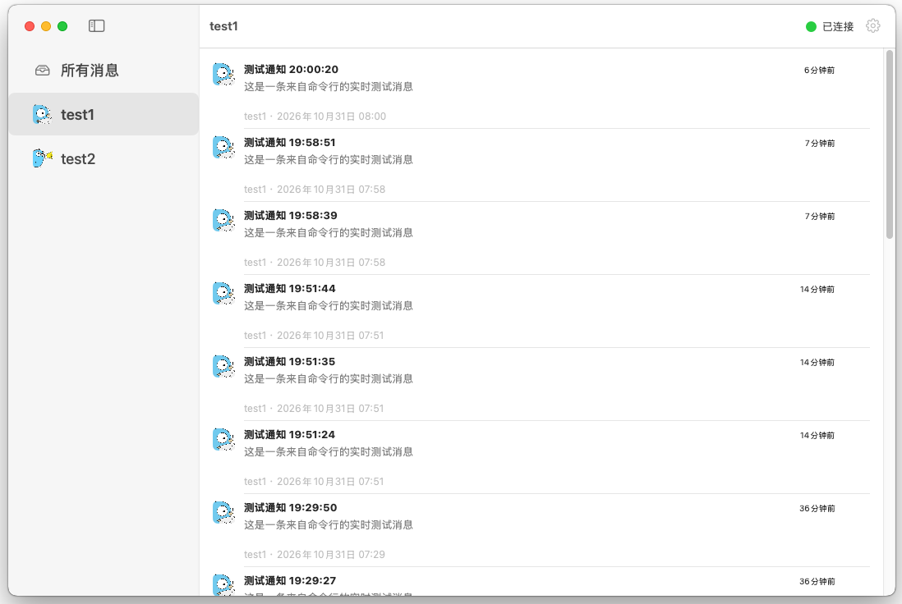

# Gotify Desktop (GotifyDesktop)

[](https://github.com/goccx/GotifyDesktop/releases/latest)
[-blue)](https://github.com/goccx/GotifyDesktop/releases/latest)
[](LICENSE)

[English](README.md) | 简体中文

**Gotify Desktop**（`GotifyDesktop`）是一款轻量的原生 macOS [Gotify](https://gotify.net/) 桌面与菜单栏客户端，支持按应用（Application）来源分类阅读消息、通过 WebSocket 实时接收推送，并提供 macOS 原生系统通知横幅与提示音。

Gotify Desktop 专注于轻量化实时通知接收：消息属于你的 Gotify 服务端，客户端仅在运行期间于内存中展示和通知，不建立本地消息数据库，关闭主窗口后可继续驻留系统菜单栏保持后台接收。



## 下载与安装

### 支持平台与安装包下载

支持 **macOS 12.0 (Monterey)** 及更高版本，请根据你的 Mac 芯片类型选择对应安装包：

| 平台架构 | 适用机型 | 下载链接 |
| :--- | :--- | :--- |
| **Apple Silicon (`arm64`)** | M1 / M2 / M3 / M4 系列芯片 Mac | 📦 [**GotifyDesktop-macOS-arm64.dmg**](https://github.com/goccx/GotifyDesktop/releases/latest/download/GotifyDesktop-macOS-arm64.dmg) |
| **Intel (`amd64`)** | Intel `x86_64` 处理器 Mac | 📦 [**GotifyDesktop-macOS-amd64.dmg**](https://github.com/goccx/GotifyDesktop/releases/latest/download/GotifyDesktop-macOS-amd64.dmg) |

🔗 [查看全部版本与更新日志 (GitHub Releases)](https://github.com/goccx/GotifyDesktop/releases)

### 首次打开说明

将 `.dmg` 中的 `GotifyDesktop.app` 拖入 `Applications`（应用程序）后，若提示 **“Apple 无法验证 GotifyDesktop 是否包含恶意软件”**，任选一种方式放行：

- **终端放行**：`xattr -rd com.apple.quarantine /Applications/GotifyDesktop.app`
- **系统设置放行**：在弹窗点**“完成”** → **系统设置 → 隐私与安全性** → 底部点击**“仍要打开”**。

## 功能特性

- **固定两栏布局**：左侧按 Gotify 应用（Application）来源导航，右侧为消息列表与详情阅读区。
- **实时与历史同步**：单一 WebSocket 连接实时接收新消息，REST API 按需自动分页加载历史消息。
- **消息删除**：支持删除单条消息、清空指定应用全部消息以及清空全部服务端消息。
- **运行期新消息提示**：提供仅本次运行的新消息蓝点、各来源计数与列表顶部居中的新消息提示条。
- **macOS 原生集成**：常驻系统菜单栏，支持原生横幅通知及可选的 Gotify 专属提示音。
- **外观与多语言**：支持“跟随系统 / 深色 / 白色”三种主题，以及简体中文与 English 即时切换。

## 前提条件：部署 Gotify 服务端

使用本客户端前，你需要先拥有一个运行中的 Gotify 服务端。若尚未部署，可通过 Docker 或二进制文件快速搭建，详见 [Gotify 官方安装文档](https://gotify.net/docs/install)。

- **Client Token（客户端令牌）**：在 Gotify 网页后台 `[Clients]` 中创建，填入 **GotifyDesktop 偏好设置**用于接收消息。
- **Application Token（应用令牌）**：在 Gotify 网页后台 `[Apps]` 中创建，用于各发送脚本或服务向 Gotify 推送消息。

## 从源码构建

环境要求：macOS 12 或更高版本、Swift 6.1 或更高版本，以及 Xcode Command Line Tools。

```sh
make build    # 编译并组装 Debug 版 GotifyDesktop.app
make run      # 编译并直接运行 GotifyDesktop.app
make test     # 运行单元测试
make release  # 打包 arm64 与 amd64 正式版 .dmg 安装包（输出至 build/dist/）
```

## 连接服务端

1. 点击主窗口右上角齿轮图标，打开**偏好设置**。
2. 输入你的 Gotify **服务端 URL** 和 **客户端 Token（Client Token）**。
3. 打开**接收消息**开关，客户端会在验证连接成功后开始接收消息。

修改连接配置前请先关闭“接收消息”开关（关闭开关会停止当前会话并清空运行期内存消息，但不会删除已保存的连接配置）。

推荐使用 **HTTPS** 连接服务端；若使用 HTTP，界面会提示明文传输风险，需确认后方可开启连接。在偏好设置中开启**系统通知**后，收到实时新消息时会请求投递 macOS 横幅通知。

## 通知脚本

仓库 [`AgentNotify/`](AgentNotify/README.zh-CN.md) 目录提供了一组独立的单文件 Shell 推送脚本，通过 Gotify 的 **Application Token** 向服务端发送通知：

- [`gotify-notify.sh`](AgentNotify/gotify-notify.sh)：通用通知脚本，适用于流量通知、磁盘告警、定时任务等场景。
- [`antigravity-notify.sh`](AgentNotify/antigravity-notify.sh)、[`claude-notify.sh`](AgentNotify/claude-notify.sh)、[`gemini-notify.sh`](AgentNotify/gemini-notify.sh)、[`codex-notify.sh`](AgentNotify/codex-notify.sh)：分别针对 Antigravity、Claude Code、Gemini CLI 和 OpenAI Codex CLI 的任务完成 Hook 通知脚本。

详细配置说明见 [`AgentNotify/README.zh-CN.md`](AgentNotify/README.zh-CN.md)（[English](AgentNotify/README.md)）。

## 语言与主题

- **语言**：在**偏好设置 → 界面 → 语言**中选择**跟随系统、English、简体中文**，界面文案与日期格式会立即生效（服务端返回的应用名与消息内容保持原文）。绝对时间采用 24 小时制并跟随当前 macOS 系统时区。
- **外观**：在**偏好设置 → 界面 → 外观**中选择**跟随系统、深色、白色**。

## 本地数据与隐私

- **消息不落盘**：消息正文、分页状态和新消息标记仅存在于进程内存中，应用退出即清空，下次启动时重新从服务端拉取。
- **连接与偏好存储**：服务端地址、界面主题和通知偏好保存在 `UserDefaults` 中；`Client Token` 使用 Apple `CryptoKit`（AES-GCM）加密后存储，避免在偏好文件中出现明文。
- **应用图标缓存**：`Nuke` 将服务端应用图标原始文件缓存在 `~/Library/Caches/com.gotify.desktop/ApplicationIcons`（上限 50 MiB），可在偏好设置中随时查看或一键清除。直接将 `.app` 拖入废纸篓不会自动删除 `UserDefaults` 偏好与该图标缓存目录。

## 开发说明

- 核心源码位于 `Sources/GotifyDesktop/`，单元测试位于 `Tests/GotifyDesktopTests/`。
- `OpenAPI/` 存放官方 Swagger 规范与生成配置，`Tools/OpenAPIGenerator/Generated/` 为自动生成的 Swift 客户端代码（请勿手工编辑）。仓库已包含生成好的客户端代码，日常构建无需安装 Java。
- 如需重新生成 OpenAPI 客户端（需 Java 17+ 与 OpenAPI Generator 7.24.0）：
  ```sh
  openapi-generator generate \
    --generator-name swift6 \
    --input-spec OpenAPI/gotify-openapi.json \
    --config OpenAPI/config.yaml \
    --output Tools/OpenAPIGenerator/Generated
  ```
- 界面本地化资源位于 `Sources/GotifyDesktop/SharedUI/Localization/Resources/`（`en.lproj` 与 `zh-Hans.lproj`）。

## 许可证与第三方声明

- **开源许可**：GotifyDesktop 采用 [MIT License](LICENSE) 授权，允许使用、修改、分发及商用，但须保留版权与许可声明。
- **第三方声明**：[`THIRD_PARTY_NOTICES.md`](THIRD_PARTY_NOTICES.md) 记录了第三方组件与资源（如 SwiftUIIntrospect、Gotify 通知音效等）的版权与原许可证声明，并随应用包分发。
- **图标与形象署名**：应用图标与截图中出现的 Go Gopher（土拔鼠）形象由 [Renee French](https://go.dev/blog/gopher) 设计，采用 [CC BY 4.0](https://creativecommons.org/licenses/by/4.0/) 国际许可协议授权（Gotify 变体形象来自 [gotify/logo](https://github.com/gotify/logo)）。

## 免责声明

1. **非官方客户端**：GotifyDesktop 是独立的第三方开源客户端，与 [Gotify](https://gotify.net/) 官方项目不存在隶属、赞助或背书关系。
2. **按原样提供**：本软件按 MIT 许可证“原样（AS IS）”提供，不附带任何明示或暗示的担保。
3. **安全责任**：请妥善保管你的 Gotify `Client Token` 与 `Application Token`，并优先通过受信任的 HTTPS 连接你的自建服务端；因使用明文 HTTP、凭据泄露或不当配置导致的风险由使用者自行承担。
